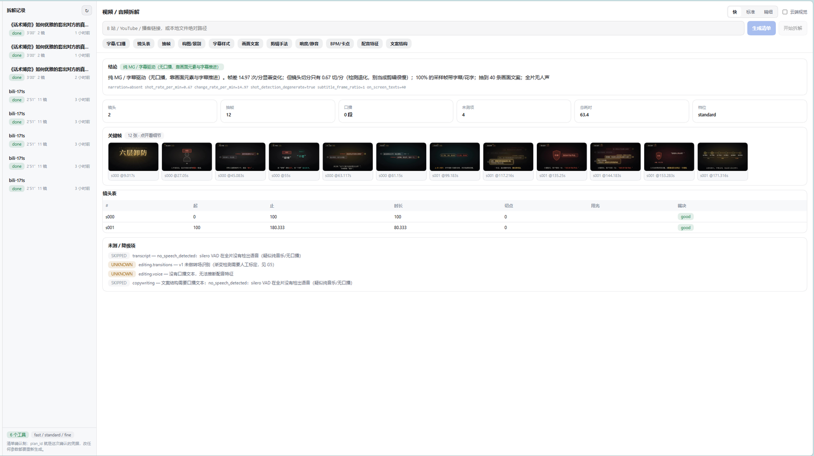

# reelens

**Turn one video or podcast into a structured breakdown report** — shots, keyframes,
transcript, on-screen text, editing rhythm, audio — where every field says *how it was
measured* and *what it cannot tell you*.

[](https://github.com/KAN-H/reelens/actions/workflows/ci.yml)
[](https://pypi.org/project/reelens/)
[](https://github.com/KAN-H/reelens/releases)
[](LICENSE)
[](python/pyproject.toml)
[](https://github.com/KAN-H/reelens)



Ships two things in one repository:

- **`reelens` core** — a dependency-free Python package and CLI. Works standalone.
- **a DeepSeek Harness plugin** — six chat tools plus the panel above. A thin shell over the CLI.

---

## Why another video analyzer

Most tools give you numbers. This one tells you **which numbers are trustworthy**:

| Status | Meaning |
|---|---|
| `MEASURED` | measured directly, method calibrated |
| `DERIVED` | a proxy computed from measurements — usable, but labelled as a proxy |
| `ASSUMED` | an inference; reference only |
| `UNKNOWN` / `SKIPPED` / `FAILED` | not measured — and **why** |

Every section carries its `method` and `params`. Anything non-conclusive rolls up into
`unknowns[]`, and a section you asked for but did not get makes `ok=false` with a non-zero
exit code. The report never quietly claims more than it did.

Two examples of that stance being *useful*:

- A **music-only video** is reported as "nobody is speaking" instead of presenting a Whisper
  hallucination as a transcript.
- Videos with a **static background and moving layers** (MG / subtitle-driven) are flagged
  `shot_detection_degenerate`: scene detection finds 0.7 cuts/min while the frame difference
  shows 15 changes/min. "Few cuts" does not mean "slow editing".

## What it measures

| Section | Content |
|---|---|
| Source | resolution, rotation, fps, codec, audio and subtitle tracks |
| Shots | per-shot start/end, cut score, exposure / shake / detail proxies, frame-difference rhythm |
| Frames | per-shot keyframes, dHash de-duplication, a minimum frame budget, contact sheet |
| Transcript | embedded subtitles → faster-whisper (int8 CPU) → whisper.cpp; auto language, speech-presence probe, hallucination guard |
| Visual | shot size, composition, subject, subtitle style, on-screen text — via a vision chain with a four-image known-answer probe |
| Editing / audio | loudness, silence, BPM, beat sync, speech rate, and a one-line conclusion derived from the signals |
| Copy / summary | hook and sentence stats, section split, CTAs; plus an extractive summary — **no model call**, so every line can be checked against the transcript |

## Install

```bash
pip install "reelens[asr,scenes,audio,images]"   # pick the extras you need
reelens probe                                    # what is available right now
```

`ffmpeg`/`ffprobe` must be on `PATH` for the CLI. The DeepSeek Harness plugin also ships both
binaries as npm dependencies (see below), so a plugin install needs no system FFmpeg.
ASR, scene detection, beat analysis and image work are
optional extras — without them those sections report `SKIPPED` with a reason instead of
failing the run.

From source, for development:

```bash
git clone https://github.com/KAN-H/reelens && cd reelens/python
pip install -e ".[asr,scenes,audio,images]"
```

Each release also carries the wheel, sdist and `SHA256SUMS.txt` as assets, if you prefer to
install without PyPI.

## Use

```bash
reelens run  "https://www.bilibili.com/video/BV..." --out out/clip --tier standard
reelens run  /path/to/podcast.mp3 --out out/pod --items transcript,summary
reelens report out/clip --markdown          # or read out/clip/breakdown.json
```

`--items` really gates the work: asking only for `transcript` skips shots, frames and the
vision model (a 45-minute audio then takes ~9 minutes instead of ~15).

### As a DeepSeek Harness plugin

```bash
pwsh -File scripts/setup.ps1                    # Windows; or: sh scripts/setup.sh
dsh plugin --profile web add /path/to/reelens   # or add a link: entry to the profile
dsh stop && dsh start                           # the host loads plugin code at startup
```

The setup script is idempotent: it runs `npm install --omit=dev` (the bundled FFmpeg/FFprobe),
creates `.venv-breakdown`, installs the Python core, and finishes with `reelens probe`.
The core resolves `ffmpeg`/`ffprobe` in this order: `REELENS_*` (or legacy `BREAKDOWN_*`)
env var → the plugin's own `node_modules` → `PATH`.

Then either ask the agent (tools `breakdown_plan / run / status / report / frames / probe`)
or open the **Breakdown** entry in the sidebar. Reload the page after the first restart —
the client bundle is fetched when the page boots.

## The contract that makes it composable

- **Plan before spend.** `breakdown_plan` returns what will be done, what it will cost, and
  who the frames will be sent to; nothing is downloaded or analysed until you confirm with
  the returned `plan_id`.
- **Canonical JSON, not prose.** Tools return structured values (they stay usable in PTC
  mode, where the model only sees `run_code`).
- **No hidden model calls.** Vision is the only thing that leaves the machine, it is opted
  into explicitly, and `PRIVACY.md` spells out the data flow.

## Documentation

- [`docs/DETAIL.md`](docs/DETAIL.md) — measurement details, thresholds and the decisions
  behind them
- [`PRIVACY.md`](PRIVACY.md) — what leaves your machine, and how to turn it off
- [`CHANGELOG.md`](CHANGELOG.md) — what changed, per release
- [`CONTRIBUTING.md`](CONTRIBUTING.md) — tests, conventions, and the one rule for new
  measurements
- [`PROVENANCE.md`](PROVENANCE.md) — how this code came to be, and what it is *not*

## Credits

This project is a thin layer over excellent tools, none of which are bundled here:
[FFmpeg](https://ffmpeg.org/) (scene score, loudness, silence, decoding),
[whisper.cpp](https://github.com/ggerganov/whisper.cpp) and
[faster-whisper](https://github.com/SYSTRAN/faster-whisper) (speech),
[PySceneDetect](https://www.scenedetect.com/) (optional cross-check for cut detection),
[librosa](https://librosa.org/) (beats), [Pillow](https://python-pillow.org/) (image work)
and [yt-dlp](https://github.com/yt-dlp/yt-dlp) (URL sources).

No third-party source code is copied into this repository — those libraries are imported or
invoked as external programs. Licenses, including the **GPL caveat for `--enable-gpl`
FFmpeg builds** (which you must check with `ffmpeg -L` before redistributing a bundle), are
listed in [`THIRD_PARTY_NOTICES.md`](THIRD_PARTY_NOTICES.md).

## License

Apache-2.0. See [`LICENSE`](LICENSE) and [`THIRD_PARTY_NOTICES.md`](THIRD_PARTY_NOTICES.md).
