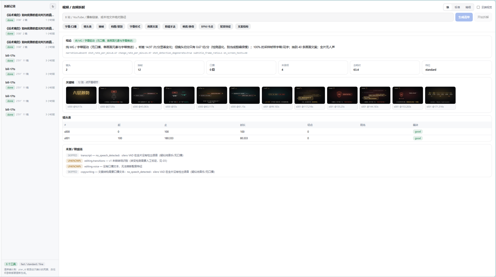

# reelens

**Turn one video or podcast into a structured breakdown report** — shots, keyframes,
transcript, on-screen text, editing rhythm, audio — where every field says *how it was
measured* and *what it cannot tell you*.

This package is the standalone core: a Python library plus the `reelens` CLI. It is also the
engine behind the [DeepSeek Harness plugin](https://github.com/KAN-H/reelens) in the same
repository, which adds six chat tools and a panel on top of it.



## Install

```bash
pip install "reelens[asr,scenes,audio,images]"   # pick the extras you need
reelens probe                                    # what is available right now
```

`ffmpeg` and `ffprobe` must be on `PATH`. The core has **no required dependencies** — ASR,
scene detection, beat analysis and image work are optional extras. Without them those
sections report `SKIPPED` with a reason instead of failing the run.

## Use

```bash
reelens run  "https://www.bilibili.com/video/BV..." --out out/clip --tier standard
reelens run  /path/to/podcast.mp3 --out out/pod --items transcript,summary
reelens report out/clip --markdown
```

Every section of the report carries a status:

| Status | Meaning |
|---|---|
| `MEASURED` | measured directly, method calibrated |
| `DERIVED` | a proxy computed from measurements — usable, but labelled as a proxy |
| `ASSUMED` | an inference; reference only |
| `UNKNOWN` / `SKIPPED` / `FAILED` | not measured — and why |

Non-conclusive sections roll up into `unknowns[]`; a section you requested but did not get
makes `ok=false` with a non-zero exit code.

## Documentation

- [Repository and full documentation](https://github.com/KAN-H/reelens)
- [Measurement details](https://github.com/KAN-H/reelens/blob/main/docs/DETAIL.md)
- [Privacy — what leaves your machine](https://github.com/KAN-H/reelens/blob/main/PRIVACY.md)

## License

Apache-2.0.
